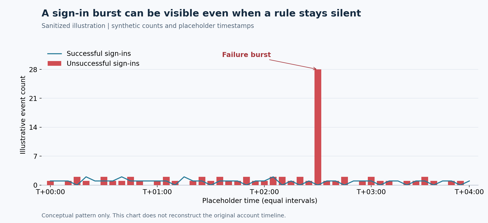
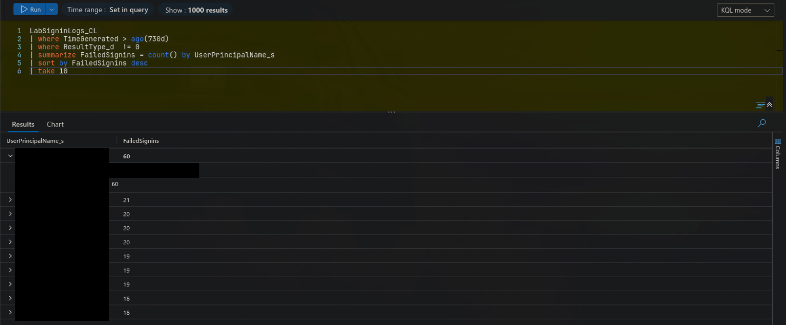
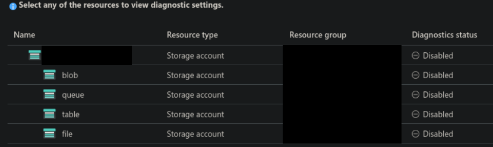
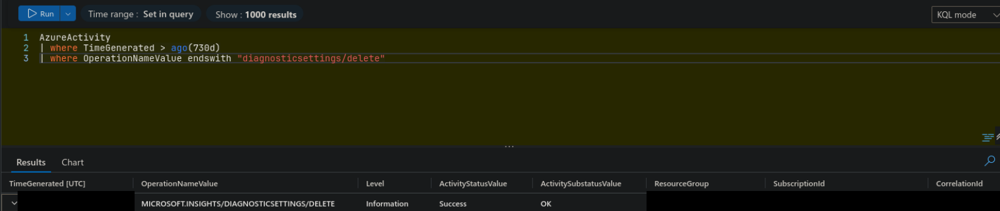
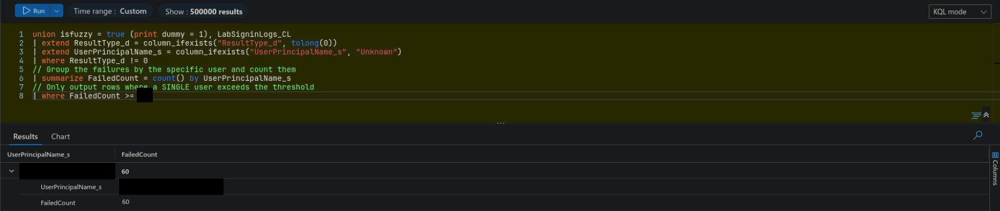
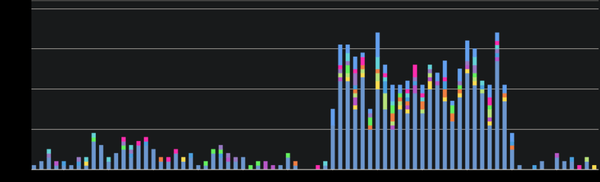

# Find the Anomaly: A KQL Threat Hunt and Two Monitoring Gaps

**Siavash Etesham** | Azure Log Analytics · KQL · Azure Monitor · Detection Engineering

I investigated a simulated suspicious-account ticket in an unfamiliar Azure Log Analytics workspace. The hunt isolated one account with a disproportionate number of unsuccessful sign-ins and exposed two separate monitoring failures: deleted storage diagnostic settings and sign-in alert logic whose threshold excluded the observed activity.



*Illustrative chart with synthetic counts and placeholder timestamps. It communicates the detection problem without presenting invented values as original evidence.*

## The ticket

> SOC handed me a ticket along with a Log Analytics workspace pre-loaded with a week of simulated sign-in data, audit events, and resource activity. Somewhere in the noise is an account with odd activity.

I had Reader access to the lab resource group and Log Analytics Reader access to the workspace. My job was to find the suspicious account, understand the available evidence, and explain why monitoring had missed the activity. Infrastructure and alert changes would require an authorized resource owner.

## The hunt

### 1. Get oriented before choosing a table

I started with the case identifier. A workspace-wide `search` located the night-shift handoff without requiring me to know the table schema in advance. I then inspected the available tables and narrowed the investigation to the custom sign-in table, `LabSigninLogs_CL`, and management-plane events in `AzureActivity`.

```kusto
// Placeholder case identifier; use the incident's actual time range in Logs.
search "CASE-EXAMPLE"
```

The distinction between discovery and analysis mattered. A broad search helped me find the handoff; table-specific queries let me investigate efficiently. My original lab queries used a wide relative lookback to reach historical records. For a repeatable investigation, I would replace that with explicit UTC start and end times covering the supplied seven-day dataset.

### 2. Rank the failures, then investigate the account

I filtered for nonzero sign-in results, grouped by user principal name, counted the events, and sorted the accounts by failure volume. One account stood above the others, with nearly three times as many unsuccessful sign-ins as the next account in the result set. That gave me a defensible pivot instead of a guessed username.

```kusto
// Sanitized example dates; replace with the actual seven-day case window.
let InvestigationStart = datetime(2026-01-01T00:00:00Z);
let InvestigationEnd = datetime(2026-01-08T00:00:00Z);
LabSigninLogs_CL
| where TimeGenerated >= InvestigationStart and TimeGenerated < InvestigationEnd
| where isnotnull(ResultType_d) and ResultType_d != 0
| summarize FailedSignins = count() by UserPrincipalName_s
| top 10 by FailedSignins desc
```



*Original lab query and ranked results. Account identities are redacted; event counts remain visible to show the outlier.*

Next, I filtered to the selected account and projected event time, result code, source IP, and application, sorting chronologically. The lab's hunt led to a successful sign-in after the unsuccessful activity. The pattern to investigate is repeated failures from an unfamiliar source followed by a success: the transition is more consequential than a high failure total alone. I would compare the source and application across that transition before attributing it to credential compromise.

```kusto
// Sanitized example dates and account identity.
let InvestigationStart = datetime(2026-01-01T00:00:00Z);
let InvestigationEnd = datetime(2026-01-08T00:00:00Z);
let TargetAccount = "account-a@example.invalid";
LabSigninLogs_CL
| where TimeGenerated >= InvestigationStart and TimeGenerated < InvestigationEnd
| where UserPrincipalName_s =~ TargetAccount
| project TimeGenerated, ResultType_d, IPAddress_s, AppDisplayName_s
| order by TimeGenerated asc
```

Nonzero results are a starting filter, not proof of password guessing. Microsoft documents `50126` as invalid username or password and `50127` as a missing broker application. I would validate each result's meaning against the event details before classifying the authentication activity. [1]

## The gap

### Finding 1: Storage visibility had been removed

The storage diagnostic-settings view showed logging disabled. That established a current coverage gap, but it did not explain whether logging had never been configured or had subsequently been removed. I queried `AzureActivity` for diagnostic-setting deletion operations and found a successful `MICROSOFT.INSIGHTS/DIAGNOSTICSETTINGS/DELETE` event. The expanded resource path in the original record identified the affected storage resource and setting.





The impact was a loss of storage data-plane visibility: without those resource logs, the defender cannot reconstruct who reached the data, which operations they performed, and how they authenticated from that logging path. A management-plane deletion event can explain why collection stopped; it does not substitute for the missing data-access records. Azure Activity Log collection and resource-log collection are separate mechanisms. [2][3]

Disabling cloud logging is consistent with **MITRE ATT&CK T1685.002, Disable or Modify Cloud Log**. The deletion is evidence of logging impairment; establishing malicious intent or attributing it to the suspicious account would require the caller, authorization context, and surrounding activity. [4]

### Finding 2: The data existed, but the detection excluded it

The authentication records were present and queryable. I reviewed the failed-sign-in rule and found that its configured count threshold exceeded the activity observed in the hunt. Replaying its counting logic in Logs with a lower cutoff returned the suspicious account.



This was a detection-logic gap, separate from the storage collection gap. Raising a blanket threshold may reduce alert volume while also excluding the behavior the rule was intended to catch. The replay demonstrated that the account could satisfy a lower cutoff; it did not demonstrate a saved rule change or an end-to-end notification.

Before promoting a fix, I would test the same aggregation, time window, evaluation frequency, and trigger operator used by the deployed rule. A seven-day hunt total cannot automatically be compared with a short-window scheduled rule, and `>` and `>=` differ at the boundary. I would also verify that an enabled rule routes to a working action group. [5]

### Check the result visually

I reviewed the lab's existing Sign-Ins Anomaly workbook as a second view of the outlier and elevated activity. It made the pattern easier to inspect than a ranked table alone.



*The supplied workbook redistributes injected event timestamps for presentation. This view supports visual review of the exercise; the account's raw records remain the source for chronological analysis.*

A workbook gives an analyst another way to spot a rule miss. It still depends on collected data and someone reviewing it; it cannot reveal storage events that were never retained.

## What I would do

1. **Restore storage logging.** Re-create the required diagnostic settings for the affected storage services, enable the needed read/write/delete categories, and verify fresh events reach the intended workspace. Re-enabling collection does **not** retroactively recover missing events; check any independent retained copies separately. [3]
2. **Enforce coverage with Azure Policy.** Assign diagnostic-setting policies at the appropriate scope, including the relevant storage service resources and destinations. Use `deployIfNotExists` with a correctly permissioned managed identity, remediate existing noncompliant resources, and monitor compliance. Policy evaluation is not an instant tamper alert. [6]
3. **Alert on removal.** Create an Activity Log alert for `Microsoft.Insights/diagnosticSettings/delete`, route successful deletions to an owned action group, and test delivery. Review diagnostic-setting updates that disable categories or change destinations as well. [5]
4. **Retune and validate the sign-in detection.** Narrow by account, source, application, and credential-related failure codes before increasing thresholds. Replay suspicious and benign periods using the rule's actual window, test the resulting notification, and retain a workbook with a documented review cadence as a second check.

## Sign-off

I oriented in an unfamiliar workspace, narrowed the hunt to one account, identified logging impairment and an alert-logic gap, and checked the pattern in a workbook; remediation and alert-delivery validation remain follow-up actions.

## Query companion

The [KQL companion](queries/find-the-anomaly/README.md) contains the discovery, ranking, timeline, logging-change, and visualization queries. These use sanitized parameters and distinguish the lab's custom schema from production Entra sign-in tables.

## References

1. [Microsoft Entra authentication and authorization error codes](https://learn.microsoft.com/en-us/entra/identity-platform/reference-error-codes)
2. [Azure Activity Log](https://learn.microsoft.com/en-us/azure/azure-monitor/essentials/activity-log)
3. [Monitor Azure Blob Storage: resource-log collection](https://learn.microsoft.com/en-us/azure/storage/blobs/monitor-blob-storage)
4. [MITRE ATT&CK T1685.002: Disable or Modify Cloud Log](https://attack.mitre.org/techniques/T1685/002/)
5. [Create an Activity Log alert rule](https://learn.microsoft.com/en-us/azure/azure-monitor/alerts/alerts-create-activity-log-alert-rule)
6. [Create diagnostic settings at scale with Azure Policy](https://learn.microsoft.com/en-us/azure/azure-monitor/data-collection/diagnostic-settings-policy)
