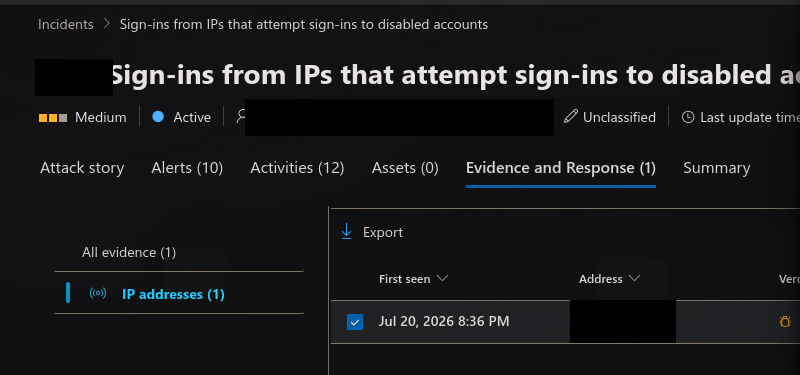
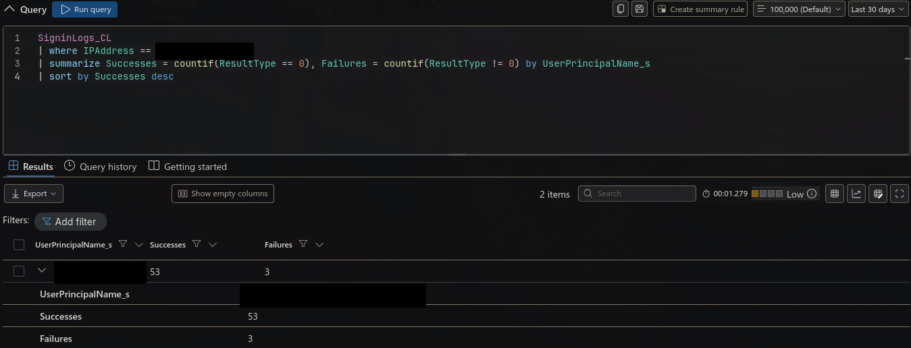
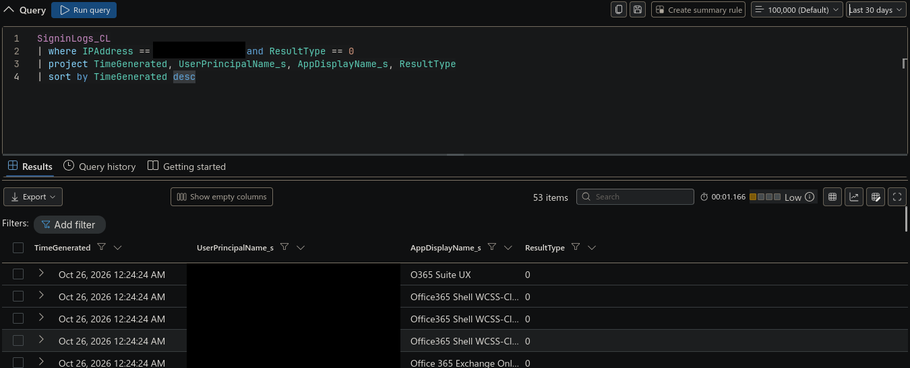
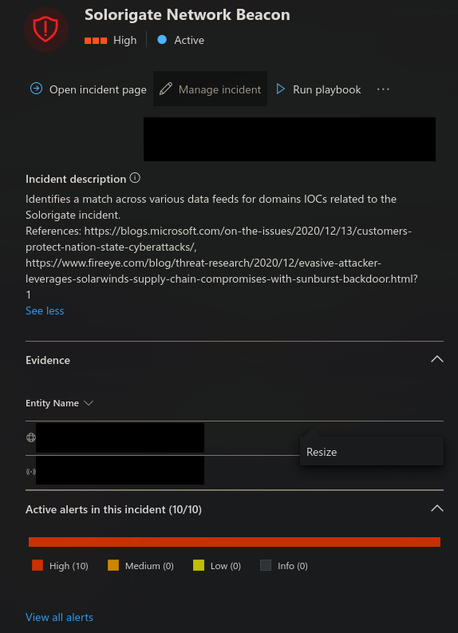
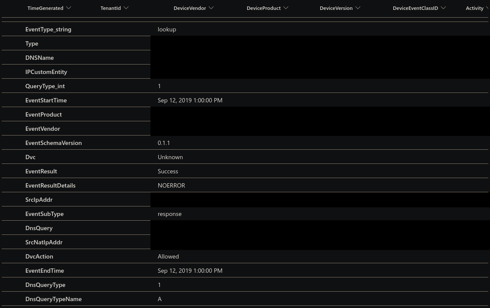
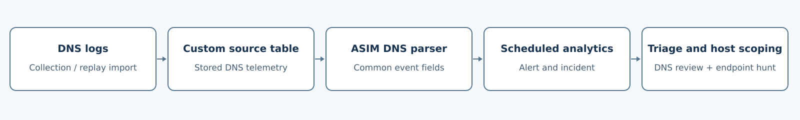

# Inside the SOC: Account Compromise and Solorigate Threat Hunting

**Microsoft Sentinel incident investigation | Mad Hat Labs, Chapter 8**  
**Tools:** Microsoft Sentinel, Microsoft Defender portal, KQL, ASIM

## Investigation overview

I investigated two incidents in a Microsoft Sentinel workspace using Microsoft's pre-recorded training telemetry. The first began with a source IP attempting authentication against disabled accounts; a KQL pivot showed successful authentication to one user account. The second began with a DNS match to known Solorigate command-and-control infrastructure; an endpoint indicator hunt expanded the investigation beyond the initially identified host.

The objective was to turn alerts into defensible decisions: identify the affected entities, distinguish observed behavior from potential impact, establish the available scope, and recommend containment. My access was limited to Microsoft Sentinel Reader and Resource Reader. The severity and classification below are my assessments; response actions are recommendations, and I did not change incident state, isolate devices, or reset credentials.

Entity values, environment identifiers, the exact affected-host total, and the DNS source table answer are withheld. Screenshots use permanent pixel redactions, and query literals use placeholders.

| Incident | Assessed severity | Classification | Decisive evidence |
| --- | --- | --- | --- |
| Suspicious authentication | High | True positive | A probing source also generated successful sign-in records for one user account. |
| Solorigate-related activity | High; immediate IR escalation | True positive | DNS matched a known C2 indicator, and an endpoint indicator hunt identified additional hosts requiring investigation. |

## Incident report 1: Suspicious authentication activity

### Severity and classification

**Severity: High. Classification: True positive within the training scenario.**

The initial incident was marked Medium in the portal. I would raise the severity after finding successful authentication from the same source associated with the disabled-account probing. That changes the response from investigating unsuccessful attempts to containing a potentially compromised identity.

**Entities involved:** source IP address, disabled user accounts, an enabled cloud user account, and cloud applications. Actual entity values are omitted.

### What happened

An incident identified a source IP attempting sign-ins to disabled accounts. I pivoted from the incident entity into the custom sign-in data and compared successful and failed authentication by account. The source also produced successful sign-ins for one user account, supporting a true-positive assessment and treating that account as compromised in the lab scenario.

### Investigation and supporting evidence

**1. Establish the lead and the query window.** I opened the incident queue, removed restrictive filters, and inspected the source IP entity. I widened the hunting window beyond the default 24 hours to include the replayed telemetry; the captured authentication queries show a 30-day selection, while the inventory hunt below uses a 180-day lookback.



*The incident supplied the initial source-IP lead. Its displayed severity preceded the successful sign-in pivot.*

**2. Compare outcomes across accounts.** I grouped events from that source by user principal name. This tested whether the activity was limited to rejected attempts or also included authenticated access.

The following is the query logic I used, with the IP replaced and the malformed quotation in my typed notes corrected. I did not re-run these examples against the expired lab session; the table and column names reflect the captured training schema.

```kusto
SigninLogs_CL
| where IPAddress == "<SOURCE_IP>"
| summarize
    Successes = countif(ResultType == 0),
    Failures = countif(ResultType != 0)
    by UserPrincipalName_s
| sort by Successes desc
```



*The captured result shows successful authentication for the account of concern. A nonzero result code indicates an unsuccessful outcome; it does not, by itself, establish that an account is disabled.*

**3. Inspect the successful records.** I filtered for successful authentication and projected timestamps, account, application, and result code. The captured result contains **53 successful sign-in records**; these are log records, not a verified count of distinct interactive sessions or unique actions.

```kusto
SigninLogs_CL
| where IPAddress == "<SOURCE_IP>" and ResultType == 0
| project TimeGenerated, UserPrincipalName_s,
          AppDisplayName_s, ResultType
| sort by TimeGenerated desc
```



*This pivot established that the source's activity included successful authentication to one user account.*

The disabled-account context came from the incident and the lab investigation. A production investigation should additionally inspect individual failure codes and account state rather than labeling every failed sign-in as a disabled-account attempt.

**Assessment and limits.** The suspicious source's successful sign-ins justify containment in this scenario. The evidence does not establish password reuse, an MFA bypass, token theft, privileged access, mailbox access, or data exfiltration. IP geolocation is enrichment only: it does not identify the operator or establish nation-state attribution. The two incidents are also not proven to be part of one attack chain.

### Recommended actions

1. **Contain the identity.** Have an authorized responder temporarily block sign-in as appropriate, reset credentials, revoke sessions and refresh tokens, and verify the effect of those actions. Do not assume a password reset immediately terminates every existing application session.
2. **Verify authentication controls.** Review MFA registration, the authentication details of the successful sign-ins, and applicable Conditional Access decisions. Remove unauthorized authentication methods or other persistence if found.
3. **Investigate activity after authentication.** Review available identity audit and application activity for consent grants, credential changes, mailbox rules, role changes, and unusual data access. Pivot on the affected identity across other source IPs as well.
4. **Address the source and validate recovery.** Consider a scoped source-IP block after checking shared egress and business impact; continue monitoring because an attacker can change infrastructure. Confirm that attempted access is rejected and investigate any new successes.

**Current disposition:** containment and post-authentication impact review recommended; successful remediation is not demonstrated by the supplied evidence.

## Incident report 2: Solorigate-related DNS activity

### Severity and classification

**Severity: High. Classification: True positive within the training scenario. Immediate escalation to incident response is recommended.**

A DNS match to known C2 infrastructure warranted urgent investigation. The subsequent endpoint hunt strengthened the assessment by finding related indicator evidence beyond the initially identified host. The potential exposure of systems and credentials makes this the higher-priority incident, even though the DNS evidence alone does not prove a completed C2 session or data theft.

**Entities involved:** a malicious domain, source IP addresses, endpoint hosts, associated account entities, and a malware-associated named-pipe indicator. Actual values and the exact host total are omitted.

### What happened

A scheduled analytics rule raised a Solorigate Network Beacon alert after DNS telemetry matched a known campaign indicator. I inspected the domain entity and supporting events, then ran the supplied inventory hunt to investigate endpoint scope. My notes record additional affected hosts beyond the initial host, supporting broader containment and escalation rather than closing the incident after identifying the domain.



*The rule description identifies a campaign-domain indicator match. The alert name alone does not demonstrate periodic beacon timing.*

### Investigation and supporting evidence

**1. Validate the alert's basis.** I inspected the incident entity and its supporting DNS evidence. The observed detection was a known-domain match; I did not independently establish periodicity, DNS tunneling, a second-stage payload, or successful remote command execution.

**2. Hunt beyond the initially identified host.** I ran the supplied Solorigate inventory query. The query captured in my notes searches Sysmon pipe events and Windows Security events for a campaign-associated named-pipe indicator. Although the lab describes broader DLL and pipe hunting, the recorded query supports a named-pipe finding; it does not document a separate DLL inventory or hash validation.

This is the captured hunt with its indicator replaced by a placeholder:

```kusto
let timeframe = 180d;
(union isfuzzy=true
    (Event
    | where TimeGenerated >= ago(timeframe)
    | where Source == "Microsoft-Windows-Sysmon"
    | where EventID in (17, 18)
    | extend EvData = parse_xml(EventData)
    | extend EventDetail = EvData.DataItem.EventData.Data
    | extend NamedPipe = EventDetail.[5].["#text"]
    | extend ProcessDetail = EventDetail.[6].["#text"]
    | where NamedPipe contains "<NAMED_PIPE_INDICATOR>"
    | extend Account = UserName
    | project-away EventDetail, EvData),
    (SecurityEvent_CL
    | where TimeGenerated >= ago(timeframe)
    | where EventID_s == "5145"
    | where AccessList_s has "%%4418"
    | where RelativeTargetName_g contains "<NAMED_PIPE_INDICATOR>")
)
| extend timestamp = TimeGenerated,
         AccountCustomEntity = Account_s,
         HostCustomEntity = Computer
| summarize arg_max(timestamp, *)
    by HostCustomEntity, AccountCustomEntity
```

**What this established:** The investigation extended beyond the DNS alert to hosts with matching endpoint indicator evidence. The exact host total is withheld as a lab answer. The supplied notes record the scope result, but do not include an inventory-results screenshot.

**Counting and schema caveats:** This query groups by **host and account**, so its row count must not automatically be reported as a unique-host count. The Sysmon branch creates `Account`, while the final projection reads `Account_s`; I would normalize the account columns across branches and validate the XML field positions before operational reuse. `isfuzzy=true` can tolerate some source-resolution failures, so I would also inspect warnings and confirm which sources actually contributed evidence.

For a follow-up scope check, after validating the returned host field, replace the final host-account summary with the following. This is a proposed refinement, not an additional query I claim to have run:

```kusto
| where isnotempty(HostCustomEntity)
| summarize by HostCustomEntity
| summarize AffectedHostCount = count()
```

**3. Trace the DNS evidence to its source.** I inspected the alert's underlying events and identified the vendor-specific custom DNS table used by the training dataset. The screenshot shows common fields such as `DnsQuery`, `SrcIpAddr`, `EventResult`, and `DnsQueryTypeName`, illustrating the normalized view the detection content consumes. The table answer and provider-identifying values are removed from this public report.



*A DNS response marked successful describes the DNS transaction; it does not prove successful malware command execution.*

### Recommended actions

1. **Escalate and contain.** Have incident response validate the host list, identify system owners and critical roles, and coordinate isolation of implicated systems. Preserve volatile and endpoint evidence where feasible without delaying necessary containment.
2. **Disrupt malicious communications.** Block validated campaign domains and relevant subdomains at managed DNS and network controls, then monitor attempted callbacks. A domain block alone does not remove the implant.
3. **Address credential exposure.** Treat credentials used on implicated systems as potentially compromised. Scope privileged and service-account exposure, revoke relevant sessions, and coordinate credential rotation from trusted systems after containment.
4. **Determine the full impact and recover.** Validate software versions and file integrity, investigate related persistence and lateral movement, and rebuild confirmed compromised hosts from trusted sources under the IR plan. Investigate exfiltration as a possibility rather than reporting it as established fact.

**Current disposition:** immediate IR escalation and broader host containment recommended; eradication, recovery, and the absence of further compromise are not demonstrated.

## How the DNS detection worked

The original data represented events from a DNS security provider. In this workspace, those events were **pre-recorded training data imported into a vendor-specific custom table**, not evidence that I configured a live production connector. The source table was identified in the underlying alert events; the supplied notes do not establish the exact ingestion API or collection transport.



*Placeholder labels intentionally omit lab resource names and answers. Endpoint telemetry supplies the final inventory hunt; DNS logs alone do not establish the entire host scope.*

ASIM provides common fields across supported sources so detection content can query a shared DNS schema. Query-time parsers can normalize existing source records without rewriting the raw table; ASIM also supports ingest-time normalization. The lab's custom-source data and normalized alert fields match the parser-based approach, but my notes don't capture the deployed parser definition. [Microsoft: ASIM overview](https://learn.microsoft.com/en-us/azure/sentinel/normalization)

| Stage | Role in this investigation |
| --- | --- |
| Collection and replay import | Made historical DNS events available in the workspace's source table. |
| ASIM normalization | Exposed common DNS fields, enabling compatible detection content across supported sources. |
| Scheduled analytics | Evaluated the indicator-match logic and generated an alert surfaced in an incident for investigation. |
| Analyst investigation | Validated the domain entity and supporting DNS records rather than relying on the alert title. |
| Endpoint hunt and scoping | Searched separate host telemetry for related indicators and identified additional hosts needing investigation. |

**Failure modes matter.** Missing DNS collection would remove this detection path. A parser that omitted the source table or mapped the queried domain incorrectly could leave raw records present while the normalized rule missed the activity. Missing endpoint logs would separately reduce confidence in the inventory scope; normalization cannot recover events that were never collected. A source-specific rule could still work without ASIM, but it would need equivalent logic for that source's schema.

Before interpreting an empty result, I would check the selected time range, table availability, retention, result warnings, schema and field types, parser output, and rule lookback. Replayed data can also have original event timestamps that differ from its workspace `TimeGenerated`; the captured DNS record illustrates that distinction. A historical hunt and a scheduled rule must each cover the intended event population. [Microsoft: using ASIM parsers](https://learn.microsoft.com/en-us/azure/sentinel/normalization-about-parsers)

## MITRE ATT&CK mapping

The mappings below separate behavior supported by the lab evidence from narrower hypotheses and historical campaign context.

| Incident | Technique | Reason and confidence |
| --- | --- | --- |
| Authentication | [T1110 - Brute Force](https://attack.mitre.org/techniques/T1110/) | Probing multiple accounts is consistent with credential-guessing activity; the precise credential method remains unverified. |
| Authentication | [T1110.003 - Password Spraying](https://attack.mitre.org/techniques/T1110/003/) | Candidate sub-technique for a multi-account pattern; sign-in results do not reveal whether the same password was reused. |
| Authentication | [T1078.004 - Valid Accounts: Cloud Accounts](https://attack.mitre.org/techniques/T1078/004/) | Successful cloud-account authentication from the suspicious source supports the lab's account-compromise assessment. |
| Solorigate | [T1071.004 - Application Layer Protocol: DNS](https://attack.mitre.org/techniques/T1071/004/) | Campaign-associated DNS activity is relevant to DNS-based C2; this investigation observed the indicator match, not command content. |

The historical supply-chain compromise explains the campaign background, but this lab did not reconstruct the original software delivery path. I would not claim observed lateral movement, credential dumping, or exfiltration solely from the known malware family's capabilities.

## Threat background

Microsoft's Solorigate reporting describes a compromised, digitally signed SolarWinds Orion component that introduced a backdoor into affected environments. For defenders, its C2 activity and potential for follow-on network compromise make correlated DNS, endpoint, and identity evidence important when scoping and responding. [Microsoft's Solorigate analysis](https://www.microsoft.com/en-us/security/blog/2020/12/18/analyzing-solorigate-the-compromised-dll-file-that-started-a-sophisticated-cyberattack-and-how-microsoft-defender-helps-protect/)

## Three detection and response improvements

### 1. Turn the authentication pivot into a detection

Create a scheduled correlation that identifies a source producing disabled-account failures and successful authentication, preserving both source IP and account entities. Validate disabled-account failure codes, distinguish event ordering, tune account-spread and lookback thresholds against a baseline, and allow for delayed logs and shared egress. This would surface the account requiring containment directly instead of requiring an analyst to discover the successful access manually. Measure precision and time from the first relevant success to alert creation before promoting it into routine monitoring.

### 2. Automate ownership and enrichment

Use incident automation rules to assign the appropriate analyst, apply investigation tags, and route high-severity C2 incidents to the IR queue. Invoke a permissioned playbook for asset criticality, identity context, and related-event enrichment; keep disruptive containment subject to the organization's approved response policy. This would reduce manual routing and repeated lookup work while retaining an auditable decision process. Measure time to assignment and enrichment completeness. [Microsoft: automation rules](https://learn.microsoft.com/en-us/azure/sentinel/create-manage-use-automation-rules)

### 3. Validate coverage from technique to telemetry

Map the authentication and DNS rules to their supported ATT&CK techniques and verify account, IP, host, and domain entity mappings. Check DNS parser output, sign-in coverage, and endpoint pipe-event collection with known test events; monitor freshness and parsing failures alongside rule status. An enabled rule or an ATT&CK coverage tile is not proof of functioning telemetry. This would expose collection and correlation gaps before they create false confidence in an apparently empty hunt.

## Prioritization and conclusion

I would prioritize the Solorigate incident for immediate IR escalation because the combination of a known C2 indicator and endpoint findings across additional hosts creates a broader containment problem and potential credential exposure. I would arrange identity containment for the authentication incident in parallel: successful access from the probing source also warrants urgent action.

The key decision was to follow what each alert actually established. Authentication failures became an account-compromise concern only after the successful sign-in pivot; the DNS alert became a broader host investigation after the endpoint hunt. Neither alert volume nor an empty query result was sufficient to determine impact or closure.

---

**Evidence basis:** my lab notes and five captured portal screenshots. **Environment:** Microsoft training telemetry in Mad Hat Labs; no production SOC employment or production incident response is implied. Public query examples contain substituted literals; no lab flag values are included.
