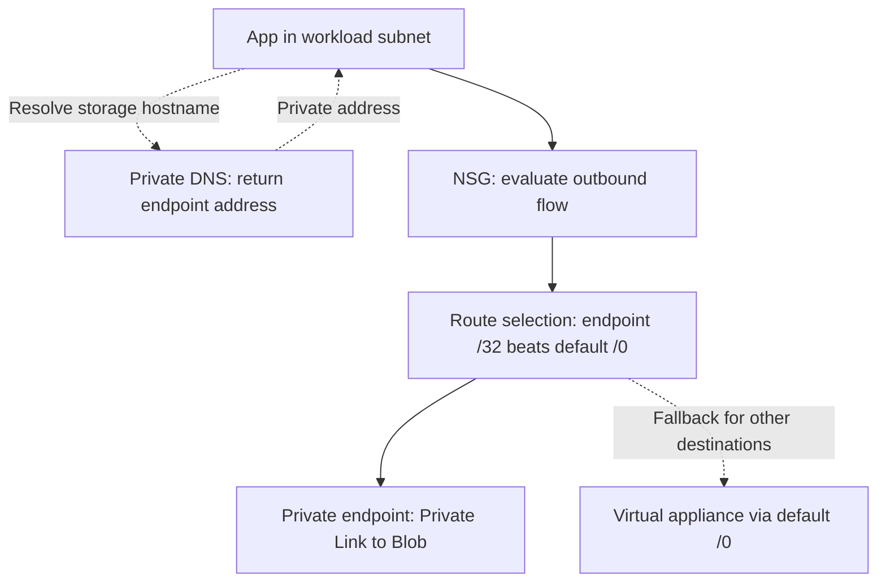

# Network Like an Operative: Explaining an Azure Private Endpoint Path

**Mad Hat Week Five | Azure networking | Read-only investigation**  
**Author:** Siavash Sean Etesham  
**Published:** October 16, 2026

An application could reach a storage account even though public network access was disabled and the workload subnet had a default route to a virtual appliance. I traced the configuration across five layers to explain why those settings were compatible.

The main finding: a forced-tunnel default route is not proof of universal inspection. In this lab's design, the private endpoint's more-specific host route takes precedence over the default route to the appliance.

## The ticket

> “Our new service can reach the customer-data storage account, but I don't understand why or how. Can someone walk me through the network path?”

My task was to answer that question from configuration, with Reader access to the lab resource group. I made no network changes. The lab recorded all five hops as completed. This publication preserves the reasoning and redacted evidence without publishing challenge answers.

## The trace

### 1. The VNet: establish the source

I opened the VNet's subnet configuration and located the workload subnet. It occupied a defined slice of the VNet's private address space and had both an NSG and a route table attached. Those associations established the starting point for the investigation and the next controls to inspect. The private endpoint address recorded later belonged to this same workload subnet. My review focused on resource-group membership, not a network boundary that permitted traffic.

*Evidence 1: The workload is the second subnet row. Names and address ranges are withheld; the control associations remain visible.*

### 2. The NSG: distinguish inbound restrictions from outbound permission

I inspected the workload subnet's NSG in both directions. Inbound TCP 443 was allowed from one specified source at priority 310, followed by an Internet-sourced deny at priority 4000. The screenshot matters: that deny targets the `Internet` service tag, rather than every possible source, and Azure's default VNet inbound allow remains below it. On the outbound side, there were no custom rules. The default `AllowVnetOutBound` rule at priority 65000 permits matching VNet traffic, which explains the NSG permission for the private endpoint connection. If present, a separate workload NIC NSG would also need to permit the flow. [1]

*Evidence 2: Inbound source restriction and Internet deny coexist with Azure's default outbound VNet allow.*

### 3. The route: explain the apparent exception

I followed the subnet's route-table association and inspected the default UDR. Its destination was `0.0.0.0/0`, and its next-hop type was `Virtual appliance`. That route handles destinations for which no more-specific route applies; it doesn't guarantee every packet crosses the appliance. Azure's private endpoint host route is `/32`, so it takes precedence over this `/0` default. That explains the lab's direct endpoint path. The screenshot captures the configured UDR, not a workload effective-route listing or firewall logs; the routing conclusion is a configuration-based explanation supported by Azure's documented behavior. [2][3]

*Evidence 3: The forced-tunnel default route is present. Its specific next-hop address is withheld.*

### 4. The private endpoint: identify the private service entry point

I located the storage private endpoint and inspected its DNS configuration, which paired a private address with the Blob storage FQDN. The endpoint address fell within the workload subnet's recorded range. The lab notes and scenario also record that the storage account has public network access disabled. Together, these explain a private path to the selected storage service through Azure Private Link. The PaaS service itself is not a VM moved into the subnet; the endpoint is its private network entry point. Private connectivity still requires storage authentication and authorization. [4]

### 5. The name: connect the hostname to the endpoint

I compared the endpoint mapping with the private-zone A record recorded in my notes. Both pointed to the same private address. The relevant zone is `privatelink.blob.core.windows.net`. The application uses the normal Blob service hostname; resolution follows its private-link alias and obtains the endpoint address through the private DNS path. A linked zone or suitable DNS forwarding configuration makes that answer available to the workload. The supplied screenshot shows the endpoint's DNS integration, but it does not capture the separate zone record set or the workload lookup. DNS resolves the destination before the storage connection begins. [4][5]

*Evidence 4: Endpoint address-to-FQDN mapping and private DNS integration. Exact addresses, names, and identifiers are removed.*

## The path in one diagram

The five “hops” are investigation layers, rather than five routers in series. The NSG filters traffic, routing selects the path, and DNS supplies the destination address. Private Link carries the storage connection over Microsoft's network without using the storage public endpoint. [4]

View the diagram as Mermaid

## The answer to the application team

Your application can reach storage because the storage hostname resolves through private DNS to a private endpoint inside the workload subnet. The subnet NSG has no custom outbound restrictions, and its default VNet outbound rule permits matching private traffic. For the endpoint destination, the more-specific `/32` route takes precedence over the `/0` route to the appliance. The endpoint then connects privately to Blob storage, so disabling the storage public endpoint does not remove this path. This explains the lab's reported connectivity and inspection bypass; it does not claim I captured packets or proved the firewall logs were absent. A workload DNS lookup and effective-route check would confirm the active path.

## What I would flag

Confirm with the network team whether private storage traffic is intentionally outside appliance inspection. Before closing a production ticket, retain the workload DNS result and effective route, check any additional NSG, and verify private endpoint approval and the storage public-access setting.

## Why the default UDR does not settle the question

The useful comparison is route specificity, not the words “user-defined” and “system.” Azure first chooses the longest matching prefix. For equal prefixes, route-source preference normally favors UDRs over BGP and system routes; that tie-break does not turn a default UDR into a host route. [3]

| Candidate route | Destination covered | Meaning for this investigation |
| --- | --- | --- |
| Private endpoint host route, `/32` | The endpoint's single address | More specific than the default route |
| Default UDR, `0.0.0.0/0` | All IPv4 destinations | Fallback through the virtual appliance |

Private endpoint routing also has an explicit policy mechanism. If inspection is required, an authorized owner must check route-table network policy support on the endpoint subnet and configure a suitable UDR override. Merely retaining the `/0` route is insufficient. Return-path symmetry and application behavior then need validation. No policy changes or rerouting were performed in this investigation. [2]

## Evidence and confidence

| Finding | Evidence available | Boundary of the conclusion |
| --- | --- | --- |
| Workload subnet has an NSG and route table | Portal subnet screenshot | Does not show every workload NIC control |
| NSG has an outbound VNet allow and no custom outbound rules | Portal NSG screenshot | Establishes permission at this NSG, not end-to-end application authorization |
| Default UDR targets a virtual appliance | Portal route screenshot | Configured route, not the workload's selected effective route |
| Blob endpoint has a private-address/FQDN mapping | Endpoint DNS screenshot and lab notes | Does not independently show connection approval |
| Storage public access is disabled | Investigation notes and lab scenario | Public-access blade is not included in the screenshots |
| Private-zone A record matches the endpoint | Investigation notes and lab scenario | Record-set screenshot and workload lookup are not included |
| Direct endpoint routing explains bypass of the default appliance path | Lab design plus documented route behavior | No packet capture or firewall-log analysis was performed |

The course's interactive simulator illustrates alternate scenarios. Its sample addresses and route entries are teaching examples, not additional configuration evidence from this investigation.

## Production follow-up and closure criteria

The following are proposed checks for an authorized operator. They are not completed tests, and some require permissions beyond the Reader scope used here.

| Check | What would close the uncertainty |
| --- | --- |
| DNS from the workload's execution environment | Normal Blob hostname resolves to the intended private endpoint address |
| Effective route from the workload NIC, where applicable | Selected route and next hop match the intended endpoint or inspection path |
| Effective security rules and endpoint network policies | Relevant controls permit the required flow and restrict unintended access |
| Endpoint and storage settings | Connection approved; intended service selected; public network access disabled as recorded |
| Required application operation | Intended identity can perform the required storage operation; reachability alone is insufficient |
| Inspection design | Network owner confirms bypass is intended, or validates an approved routing change and its return path |

## Outcome and what I learned

I completed the five-hop lab and turned the app team's vague connectivity question into a layered explanation from configuration. The result was a written ticket response, not a remediation claim or a production penetration test.

Two lessons stood out. First, a default route is a starting point for investigation, not a guarantee about every destination. Second, inbound exposure, outbound permission, name resolution, routing, and storage authorization answer different questions. Keeping them separate speeds troubleshooting and makes the explanation easier for another team to act on.

The most useful next step in a production environment is to compare that configuration explanation with the workload's results. Clear evidence boundaries are part of completing the investigation, especially when the initial access is read-only.

**Skills demonstrated:** Azure VNet and subnet analysis, NSG rule interpretation, UDR and longest-prefix reasoning, private endpoint inspection, private DNS correlation, read-only investigation, and technical ticket communication.

## References

Mad Hat 5.6 LAB: Network Like an Operative. 

Microsoft documentation supports the platform behavior discussed above.

1. [Microsoft Learn: Network security groups](https://learn.microsoft.com/en-us/azure/virtual-network/network-security-groups-overview)
2. [Microsoft Learn: Manage network policies for private endpoints](https://learn.microsoft.com/en-us/azure/private-link/disable-private-endpoint-network-policy)
3. [Microsoft Learn: Azure virtual network traffic routing](https://learn.microsoft.com/en-us/azure/virtual-network/virtual-networks-udr-overview)
4. [Microsoft Learn: Use private endpoints for Azure Storage](https://learn.microsoft.com/en-us/azure/storage/common/storage-private-endpoints)
5. [Microsoft Learn: Azure Private Endpoint DNS configuration](https://learn.microsoft.com/en-us/azure/private-link/private-endpoint-dns)

---

[Portfolio article](https://siavashetesham.com/projects/network-like-an-operative) · [Security portfolio repository](https://github.com/arbtek/security-portfolio)
